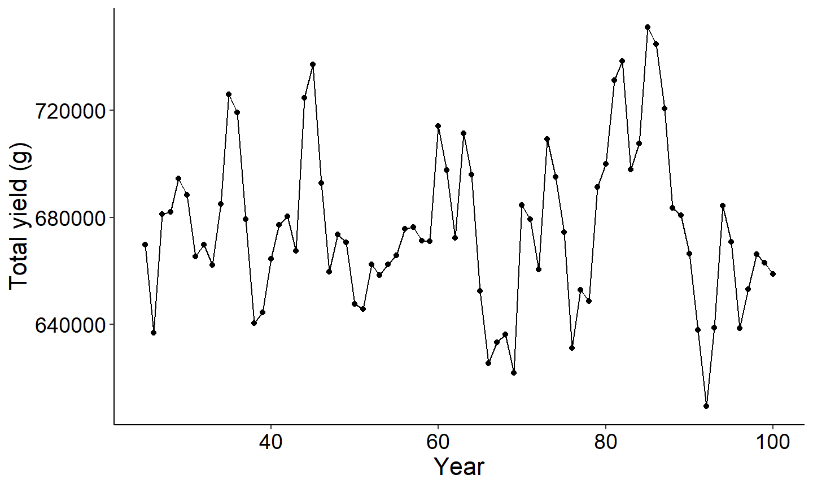
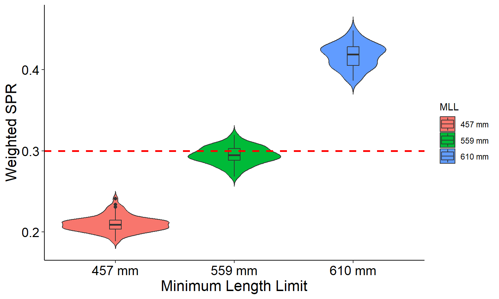

# Simulate a population using the dynamic pool model with a Ricker stock-recruitment curve

``` r

library(rFAMS)
library(ggplot2)  ## to make figures
library(dplyr)    ## for filter
library(tidyr)
```

The objective of this article is to demonstrate how to use rFAMS to
simulate a population and estimate population characteristics using the
dynamic pool model. The dynamic pool model projects a population forward
based on a Ricker stock-recruitment curve, life history parameters, and
mortality. The `dpmBH_minLL()` function has the following arguments:

- simyears: A single numeric for the lower limit of minimum length limit
  for harvest in mm.
- minLL:A single numeric representing the minimum length limit for
  harvest in mm.
- cf: A matrix of conditional fishing mortality where each row
  represents a year and each column represents age. Ages are age-0
  through maximum age.
- cm: A matrix of conditional natural mortality where each row
  represents a year and each column represents age. Ages are age-0
  through maximum age.
- lhparms: A named vector or list that contains values for each N0,
  tmax, Linf, K, t0, LWalpha, and LWbeta. See makeLH for definitions of
  these life history parameters. Also see details.
- recruitment_type: A string that indicates if recruitment is being
  supplied as a `vector` (which requires `recv` also specified or based
  on a stock-recruitment model, `stockrecruit` (which requires relevant
  coefficients also specified)
- srmod: A string that indicates the type of stock-recruitment model,
  `Ricker`, `BevertonHolt`, `Shepherd`. Required when `recruitment_type`
  = `stockrecruit`.
- a: A single numeric to represent alpha in the Ricker, Beverton-Holt,
  and Shepherd stock-recruitment models. Required when `srmod` =
  `Ricker`, `BevertonHolt`, or `Shepherd`.
- b: A single numeric to represent beta in the Ricker, Beverton-Holt,
  and Shepherd stock-recruitment models.Required when `srmod` =
  `Ricker`, `BevertonHolt`, or `Shepherd`.
- c: A single numeric to represent c in the Shepherd stock-recruitment
  models. Required when `srmod` = `Shepherd`.
- sigmaR: A single numeric to represent standard deviation of annual
  recruits in the Ricker, Beverton-Holt, and Shepherd stock-recruitment
  models. Required when `srmod` = `Ricker`, `BevertonHolt`, or
  `Shepherd`.
- recv: A numeric vector with length `simyears` that specifies the
  number of recruits each year. This vector is best generated using the
  . All values must be greater than 0. Required when `recruitment_type`
  = `vector`.
- species: is a single character to specify the species used in the
  simulation and will define the length for stock, quality, preferred,
  memorable, and trophy. Length categories are obtained from the FSA
  package, see the PSDlit documentation.
- group: is a single character to specify the sub-group name of a
  species used in the simulation and will define the length for stock,
  quality, preferred, memorable, and trophy. Length categories are
  obtained from the FSA package, see the PSDlit documentation.
- SPRdat: A named list that contains values for each `FLR`, `FLRint`,
  `FLRslope`, `MatAge`, `percF`, and `percFSpawn`. See for definitions
  of these parameters. Only used when calculating spawning potential
  ratio.
- matchRicker: A logical that indicates whether the yield function
  should match that in Ricker (). Defaults to TRUE. The only reason to
  changed to FALSE is to try to match output from FAMS. See the
  [YPR_FAMSvRICKER
  article](https://fishr-core-team.github.io/rFAMS/articles/YPR_FAMSvRICKER.md).

## Organize input parameters

`simyears` and `minLL` require a single numeric value. This example
simulates a population for 100 years with a minimum length limit of
400mm.

``` r

simyears <- 100
minLL <- 400
```

The `lhparms` requires a list or vector that is created with the
[`makeLH()`](https://fishr-core-team.github.io/rFAMS/reference/makeLH.md)
function. The
[`makeLH()`](https://fishr-core-team.github.io/rFAMS/reference/makeLH.md)
function creates a list of the life history parameters needed.
Including, the initial number of recruits, maximum age of fish in your
population, von Bertalanffy growth model parameters ($`L_\infty`$,
$`K`$, and $`t_0`$), and parameters from the log10-transformed weight
length model (alpha and beta). By default, the
[`makeLH()`](https://fishr-core-team.github.io/rFAMS/reference/makeLH.md)
returns a list. Growth length-weight model paramaters can be generated
from functions in the [FSA
package](https://fishr-core-team.github.io/FSA/index.html). See the
[Make Life History object
article](https://fishr-core-team.github.io/rFAMS/articles/MakeLH.md) for
more details. The example below uses the following life history
parameters:

``` r

# create life history parameter object
LH <- makeLH(N0=100,tmax=15,Linf=1349.5,K=0.111,t0=0.065,LWalpha=-5.2147,LWbeta=3.153)
```

`cf` and `cm` are a matrix with rows = `simyears` (number of years
specified in the simulation) and columns = `tmax` (maximum age). This
example assigns a `cm` of 0 to the first year and 0.18 to the remaining
years and is constant across ages; and a `cf` of 0 for the first year
and 0.33 to the remaining years and is constant across ages. Note, Ages
must be age-0 through maximum age. Thus, a `cf` and `cm` matrix will
have maximum age plus one column.

``` r

cm <- matrix(rep(c(rep(0,1), rep(0.18,(LH$tmax))), simyears),nrow=simyears,byrow=TRUE)
cf <- matrix(rep(c(rep(0,1), rep(0.33,(LH$tmax))), simyears),nrow=simyears,byrow=TRUE)
```

## Run the dynamic pool model

In this example, recruitment each year is generated using a Ricker
stock-recruitment curve. Other recruitment models available include
Beverton-Holt and Shepherd models. Each model requires specific
coefficients to also be specified in the `dpmBH_MinLL` function. The
Ricker model requires `a`, `b`, and `sigma`. See the [stock-recruitment
article](https://fishr-core-team.github.io/rFAMS/articles/stock_recruit.md)
for a full explanation of coefficients for each model. To initiate the
stock-recruitment model, the `recruitment_type` argument must be set to
stockrecruit. The `srmod` argument is used to specify the specific
stock-recruitment model.

The stock-recruitment models uses spawning stock calculated using the
percentage of females and percentage of spawning females at age. This
information is also used when calculating spawning potential ratio.
Therefore, the SPR data object must be specified when using a
stock-recruitment curve. See documentation for `makeSPR` for more
information.

``` r

SPRdat<- makeSPR(FLR = "linear", FLRint = -1057029, FLRslope = 2777.08, MatAge = 4,
                 percF=c(rep(0.50,15)), #required to be length of tmax
                 percFSpawn = c(0,0,0,0.24,0.24,0.53,rep(1.00,9)))  #required to be length of tmax
```

The `dpmBH_minLL` function will use the arguments above to simulate the
population based on a vector of recruitment and generate a list with two
data.frame object. The first list item contains a data.frame with a
summary by age and the second list item contains a data.frame with a
summary by year. The example used here specifies “Striped Bass” that are
in the group “landlocked”. The species and group are used to assign
appropriate PSD categories see [FSA
package](https://fishr-core-team.github.io/FSA/index.html) for more
information about PSD categories.

``` r

#run dynamic pool simulations
out1<-dpmBH_MinLL(simyears = simyears, minLL = minLL, cf = cf, cm = cm,
                  recruitment_type = c("stockrecruit"), srmod = c("Ricker"),
                  a = 6.8, b = 0.0025, sigmaR = 0.2, SPRdat = SPRdat,
                  lhparms = LH, matchRicker=FALSE,species="Striped Bass",group="landlocked")
```

View the first few lines of each summary

``` r

head(out1[[1]])  #Summary by age
#>   year yc age   length     weight    nstart exploitation expect_nat_death   cf
#> 1    1  1   0   0.0000    0.00000 100.00000    0.0000000        0.0000000 0.00
#> 2    2  1   1 133.0349   30.35037 100.00000    0.0000000        0.1800000 0.33
#> 3    3  1   2 260.8383  253.58225  82.00000    0.0000000        0.1800000 0.33
#> 4    4  1   3 375.2145  798.00101  67.24000    0.3012967        0.1493033 0.33
#> 5    5  1   4 477.5741 1707.32249  40.54091    0.3012967        0.1493033 0.33
#> 6    6  1   5 569.1797 2968.94019  22.27318    0.3012967        0.1493033 0.33
#>     cm         F         M         Z      S   biomass  nharvest      ndie
#> 1 0.00 0.0000000 0.0000000 0.0000000 1.0000     0.000  0.000000  0.000000
#> 2 0.18 0.0000000 0.1984509 0.1984509 0.8200  3035.037  0.000000 18.000000
#> 3 0.18 0.0000000 0.1984509 0.1984509 0.8200 20793.744  0.000000 14.760000
#> 4 0.18 0.4004776 0.1984509 0.5989285 0.5494 53657.588 15.828150 10.870941
#> 5 0.18 0.4004776 0.1984509 0.5989285 0.5494 69216.407 12.214843  6.052891
#> 6 0.18 0.4004776 0.1984509 0.5989285 0.5494 66127.727  6.710835  3.325458
#>      yield minLL  N0   Linf     K    t0 LWalpha LWbeta tmax notes
#> 1     0.00   400 100 1349.5 0.111 0.065 -5.2147  3.153   15      
#> 2     0.00   400 100 1349.5 0.111 0.065 -5.2147  3.153   15      
#> 3     0.00   400 100 1349.5 0.111 0.065 -5.2147  3.153   15      
#> 4 20513.92   400 100 1349.5 0.111 0.065 -5.2147  3.153   15      
#> 5 27456.93   400 100 1349.5 0.111 0.065 -5.2147  3.153   15      
#> 6 24510.96   400 100 1349.5 0.111 0.065 -5.2147  3.153   15
head(out1[[2]])  #Summary by year
#>   year age_1plus Yield_age_1plus Total_biomass nharvest_age_1plus
#> 1    1    0.0000            0.00         0.000            0.00000
#> 2    2  100.0000            0.00      3035.037            0.00000
#> 3    3  182.0000            0.00     23828.781            0.00000
#> 4    4  249.2400        20513.92     77486.369           15.82815
#> 5    5  289.7809        47970.85    146702.776           28.04299
#> 6    6  312.0541        72481.81    212830.503           34.75383
#>   ndie_age_1plus substock stock quality preferred memorable trophy       PSD
#> 1        0.00000      100     0       0         0         0      0 0.0000000
#> 2       18.00000      200     0       0         0         0      0 0.0000000
#> 3       32.76000      282     0       0         0         0      0 0.0000000
#> 4       43.63094      282    67       0         0         0      0 0.0000000
#> 5       49.68383      282   107       0         0         0      0 0.0000000
#> 6       53.00929      282   107      22         0         0      0 0.1705426
#>   PSD_P PSD_M PSD_T wtSPR
#> 1     0     0     0     0
#> 2     0     0     0     0
#> 3     0     0     0     0
#> 4     0     0     0     0
#> 5     0     0     0     0
#> 6     0     0     0     0
```

## Plot Results

The output contains a lot of information and there are several potential
figures that can be constructed. Below are examples of a few figures
that might be of interest. The first set of figures will explore the
data summarized by age and the second set of figures will explore the
data summarized by year. First, a custom theme is created to use across
all plots.

``` r

# Custom theme for plots (to make look nice)
theme_FAMS <- function(...) {
 theme_bw() +
 theme(
   panel.grid.major=element_blank(),panel.grid.minor=element_blank(),
   axis.text=element_text(size=14,color="black"),
   axis.title=element_text(size=16,color="black"),
   axis.title.y=element_text(angle=90),
   axis.line=element_line(color="black"),
   panel.border=element_blank()
 )
}
```

### Exploring the summary by age output

The three figures below plot 1) yield vs age of a single year class 2)
harvest vs age and 3) biomass vs age. Note since recruitment, cf, and cm
was fixed across all year classes, all year classes will have the same
age vs total yield.

``` r

#Plot date using summary by age for a specific year class
#filter for year class = 40
plotdat<- out1[[1]] |> filter(yc==40)

#Plot yield vs age
ggplot(data=plotdat,mapping=aes(x=age,y=yield)) +
  geom_point() +
  geom_line() +
  labs(y="Total yield (g)",x="Age") +
  theme_FAMS()
```


``` r


#Plot Number harvested vs age
ggplot(data=plotdat,mapping=aes(x=age,y=nharvest)) +
  geom_point() +
  geom_line() +
  labs(y="Number harvested",x="Age") +
  theme_FAMS()
```


``` r


#Plot Number biomass vs age
ggplot(data=plotdat,mapping=aes(x=age,y=biomass)) +
  geom_point() +
  geom_line() +
  labs(y="Biomass (g)",x="Age") +
  theme_FAMS()
```


### Exploring the summary by year output

The next set of figures will explore the output summary by year. The
first figure is PSD vs year and the second figure is Yield of age 1 plus
vs year. Note each figure reaches an asymptote once all age classes are
present in the population. This is because recruitment, cm, and cf are
held constant across years.

``` r

#Use summary by year data frame to plot PSD vs year
ggplot(data=out1[[2]],mapping=aes(x=year,y=PSD)) +
  geom_point() +
  geom_line() +
  labs(y="PSD",x="Year") +
  theme_FAMS()
```


``` r


#Use summary by year data frame to plot wtSPR vs year
ggplot(data=out1[[2]],mapping=aes(x=year,y=wtSPR)) +
  geom_point() +
  geom_line() +
  labs(y="wtSPR",x="Year") +
  theme_FAMS()
```


``` r


#Use summary by year data frame to plot yield vs year
ggplot(data=out1[[2]],mapping=aes(x=year,y=Yield_age_1plus)) +
  geom_point() +
  geom_line() +
  labs(y="Total yield (g)",x="Year") +
  theme_FAMS()
```


Because the dynamic pool models incorporate recruitment each year, it
can be more informative to restrict estimates of yield (and other
parameters) to only those years when the population has reached an
equilibrium. As you can see above, the effect of recruitment does not
stabilize until year 25 The next plot uses a filtered data set that only
includes the output when year \> 24

``` r

out1[[2]] |> 
dplyr::filter(year>24) |> 
ggplot(mapping=aes(x=year,y=Yield_age_1plus)) +
  geom_point() +
  geom_line() +
  labs(y="Total yield (g)",x="Year") +
  theme_FAMS()
```



## Spawning potential ratio (SPR) across multiple minimum length limits

There are several interesting questions that can be answered using the
dynamic pool model. For example, how does mean spawning potential ratio
change under three different minimum size limits? The code below
explores this question. Assuming cf, cm, and all life history parameters
used above.

``` r

out457<-dpmBH_MinLL(simyears = simyears, minLL = 457, cf = cf, cm = cm,
                   recruitment_type = c("stockrecruit"), srmod = c("Ricker"),
                   a = 6.8, b = 0.0025, sigmaR = 0.2, SPRdat = SPRdat,
                   lhparms = LH, matchRicker=FALSE,species="Striped Bass",group="landlocked")

out559<-dpmBH_MinLL(simyears = simyears, minLL = 559, cf = cf, cm = cm,
                   recruitment_type = c("stockrecruit"), srmod = c("Ricker"),
                   a = 6.8, b = 0.0025, sigmaR = 0.2, SPRdat = SPRdat,
                   lhparms = LH, matchRicker=FALSE,species="Striped Bass",group="landlocked")

out610<-dpmBH_MinLL(simyears = simyears, minLL = 610, cf = cf, cm = cm,
                    recruitment_type = c("stockrecruit"), srmod = c("Ricker"),
                    a = 6.8, b = 0.0025, sigmaR = 0.2, SPRdat = SPRdat,
                    lhparms = LH, matchRicker=FALSE,species="Striped Bass",group="landlocked")

# extract wtSPR from each simulation
SPR_all <- bind_rows(
  out457[[2]] |> select(year, wtSPR) |> mutate(MLL = "457 mm"),
  out559[[2]] |> select(year, wtSPR) |> mutate(MLL = "559 mm"),
  out610[[2]] |> select(year, wtSPR) |> mutate(MLL = "610 mm"))

# Filter years > 24
SPR_filtered <- SPR_all |>
  filter(year > 24)

# Mean and SD by minimum length limit
SPR_summary <- SPR_filtered |>
  group_by(MLL) %>%
  summarise(MeanSPR = mean(wtSPR, na.rm = TRUE),
            SDSPR = sd(wtSPR, na.rm = TRUE),
            .groups = "drop")

# View results
SPR_summary
#> # A tibble: 3 × 3
#>   MLL    MeanSPR   SDSPR
#>   <chr>    <dbl>   <dbl>
#> 1 457 mm   0.210 0.00982
#> 2 559 mm   0.294 0.0109 
#> 3 610 mm   0.417 0.0150

# Violin plot with embedded boxplot and 
# horizontal red line at desired threshold
ggplot(SPR_filtered,
       aes(x = MLL, y = wtSPR, fill = MLL)) +
  geom_violin(trim = FALSE) +
  geom_boxplot(width = 0.1) +
  geom_hline(yintercept = 0.3, linetype = "dashed", color = "red", linewidth = 1)+
  theme_FAMS() +
  labs(x = "Minimum Length Limit",
       y = "Weighted SPR") +
  theme_FAMS()
```



The simulations indicated that minimum length limits of 457-mm produces
a mean weighted SPR values of 0.210 (SD = 0.010), suggesting that fish
protected with this size limit contribute relatively little to overall
spawning output. This result is consistent with the growth and maturity
assumptions used in the model. Based on the von Bertalanffy growth
parameters, the mean length at age 4 is 445.8 mm, and only 24% of
females are assumed to be mature and contribute to egg production at
that age. Therefore, many of the fish would be harvested before
successful reproduction. Increasing the minimum length limit to 559-mm
improved SPR to a mean of 0.294 (SD = 0.013). In contrast, increasing
the minimum length limit to 610 mm increased mean SPR to 0.416 (SD =
0.019), indicating substantially greater protection of reproductive
potential. Biological reference points for SPR vary among species and
populations; however, Goodyear (1993) proposed an SPR threshold of 0.30,
below which recruitment failure becomes increasingly likely. Under this
criterion, the 457 and 559-mm minimum length limits would result in SPR
values below the threshold, whereas the 610-mm and above minimum length
limit would maintain SPR above it.

## Literature Cited

Goodyear, CP. 1993. Spawning stock biomass per recruit in fisheries
management: foundation and current use. Canadian Special Publication of
Fisheries and Aquatic Sciences 120:67–81.
